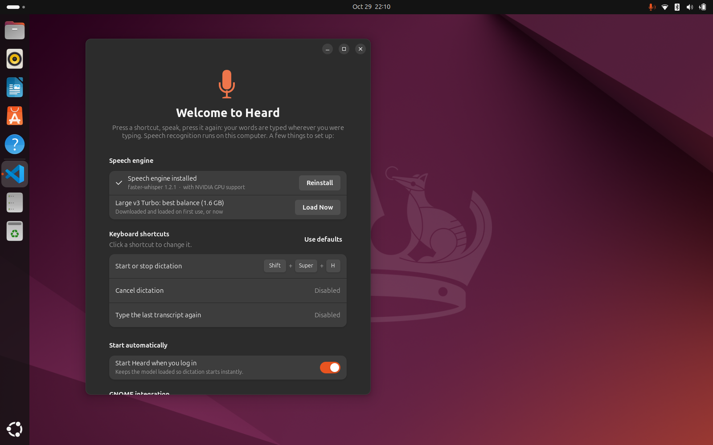
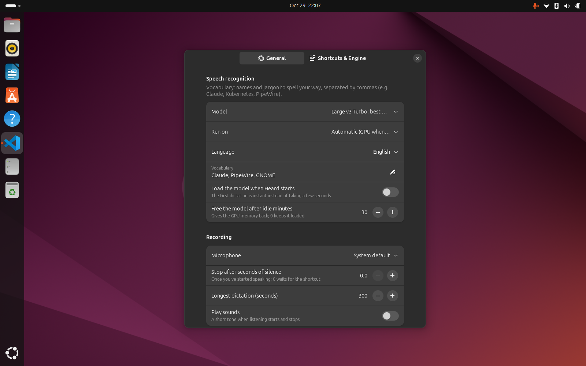
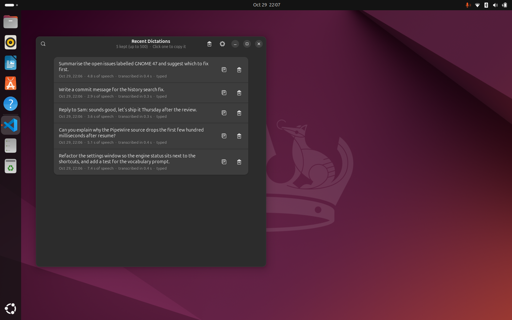

# Heard

[](https://github.com/jksnetwork/heard/actions/workflows/ci.yml)
[](LICENSE)

**Speak instead of typing, in any app, on Linux.**

Press <kbd>Shift</kbd>+<kbd>Super</kbd>+<kbd>H</kbd>, say what you want, press it again. Your words are typed wherever the cursor is: a terminal, a chat box, an AI prompt, a code editor. Speech recognition is [Whisper](https://github.com/openai/whisper) running on your own computer, so nothing you say leaves it.

Heard is the dictation companion to [Screend](https://github.com/jksnetwork/screend): same idea, same feel. A resident service, a global shortcut, and a small GNOME Shell extension that does what a Wayland app can't do on its own.

| Listening | Transcribing |
|---|---|
|  |  |

## Highlights

- **Fast.** With an NVIDIA GPU, a 20-second dictation is typed about 0.7 s after you stop talking. The model stays loaded between dictations.
- **Private.** Whisper (via [faster-whisper](https://github.com/SYSTRAN/faster-whisper)) runs locally. History keeps text only, never audio.
- **Types where you are.** No window pops up and nothing takes focus. A small pill at the top of the screen shows that it's listening, with a level meter and stop/cancel buttons.
- **Accurate punctuation and capitals**, plus a vocabulary list for names and jargon ("Claude, Kubernetes, PipeWire").
- **Hands-off option:** stop automatically after a pause.
- **History** of everything you've dictated, searchable, one click to copy. Retype the last one with a shortcut.
- **Tray icon**, settings window and a welcome screen that sets everything up.

| Welcome | Settings | History |
|---|---|---|
|  |  |  |

## Install

### Any distro (one line, no root)

```bash
curl -fsSL https://raw.githubusercontent.com/jksnetwork/heard/main/install.sh | bash
```

This installs Heard for your user and sets up the speech engine in a private Python environment: about 2.5 GB with NVIDIA GPU support, 300 MB without. Nothing system-wide is touched. If something is missing (GTK bindings, GStreamer plugins), it tells you the exact command for your distro. Run the same line again to update.

### From source

```bash
git clone https://github.com/jksnetwork/heard.git
cd heard
./install.sh
```

Options: `--cpu` skips the CUDA libraries, `--no-engine` leaves the engine for the welcome screen, `--uninstall` removes everything (your settings and history stay).

### Ubuntu and Debian package

`packaging/build-deb.sh` builds `dist/heard_<version>_all.deb`. The package installs the app and the GNOME extension; the welcome screen then installs the speech engine for each user.

### First run

The welcome screen sets up the speech engine, the shortcut, and start at login. On GNOME the Shell extension loads at your next login. Until then Heard types through the desktop's remote-input portal, which asks once for permission.

The first dictation downloads the speech model (1.6 GB for the default). After that, everything works offline.

## Using it

| | |
|---|---|
| <kbd>Shift</kbd>+<kbd>Super</kbd>+<kbd>H</kbd> | Start dictating; press again to stop and type the text |
| <kbd>Shift</kbd>+<kbd>Super</kbd>+<kbd>Enter</kbd> | Stop, type the text **and press Enter** (sends a chat prompt). Also starts dictating. |
| Click ■ / ➤ on the pill | Stop and type / stop, type and press Enter |
| Click ✕ on the pill | Cancel, nothing is typed |

"Cancel dictation" and "Type the last transcript again" can be bound to keys in Settings → Shortcuts. Everything is also in the tray menu and on the command line:

```
heard toggle | send | start | stop | cancel | again | history | settings | welcome | quit
```

📖 **The [user guide](docs/user-guide.md)** covers models, settings, other desktops and troubleshooting.

## Desktop support

| | GNOME | KDE Plasma | Hyprland / Sway |
|---|:-:|:-:|:-:|
| Typing into the focused app | ✅ extension (portal until next login) | ✅ with `ydotool`, else portal | ✅ with `wtype` |
| Listening indicator | ✅ extension | ✅ with `gtk4-layer-shell` | ✅ with `gtk4-layer-shell` |
| Global shortcut | ✅ set up for you | ✅ from the menu entry | your compositor config |

Without a typing tool, transcripts go to the clipboard and a notification asks you to paste.

## How it works

```
shortcut ─▶ heard toggle ─▶ resident app ─▶ GStreamer: microphone → 16 kHz mono
                                  │
                       stop ──────┤
                                  ▼
                      speech worker (engine venv) ─ faster-whisper, model kept loaded
                                  │ text
                                  ▼
                      GNOME Shell extension ─ virtual keyboard types it into the focused window
```

The speech worker runs in its own Python environment (`~/.local/share/heard/engine`), so the GTK app stays on your system Python and the CUDA libraries never touch the rest of the system. Models are cached in `~/.cache/heard/models`.

## Requirements

- Python 3.10+, GTK 4, libadwaita 1.5+, PyGObject, GStreamer with the good plugins (Ubuntu 24.04, Fedora 40 or newer)
- For GPU speed: an NVIDIA GPU with a recent driver (CUDA 12). Without one, pick a smaller model in Settings; `small.en` is quick on a modern CPU.

## License

GPL-3.0-or-later. See [LICENSE](LICENSE).
